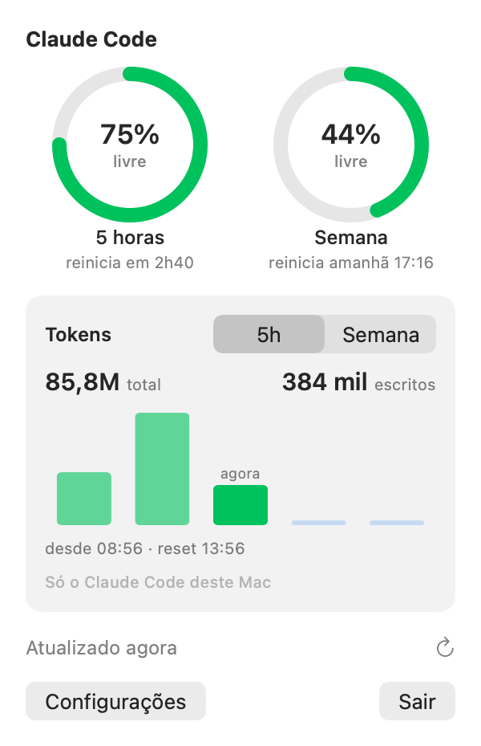

# UsageBar

App de barra de menu do macOS que mostra o consumo dos limites do Claude Code: o percentual da janela de 5 horas
no label, com uma bolinha na cor do limite semanal. Ao clicar, dois anéis mostram quanto resta em cada janela e
quando ela reinicia, e um card mostra os tokens gastos por hora (janela de 5h) ou por dia (segunda a domingo).



Cores: verde abaixo de 60%, amarelo de 60% a 85%, vermelho acima de 85%.

## Como funciona

O app junta três fontes:

1. **Servidor, a cada 5 min:** o app roda o comando `/usage` do Claude Code, que traz o uso real da conta, incluindo
   o que você usou no claude.ai. A consulta não chama o modelo e não gasta limite. Também consulta ao abrir o popover
   e no botão de atualizar. Detalhes em [`docs/usage-report.md`](docs/usage-report.md).
2. **Statusline, a cada resposta:** o Claude Code envia um JSON com os dados de uso para o comando da statusline. O
   UsageBar instala um bridge nesse caminho, e a barra muda na hora, sem esperar a próxima consulta:

   ```
   Claude Code ──stdin JSON──> ~/.claude/usagebar-bridge.sh ──grava──> ~/.claude/usagebar/state.json
                                        │                                        │
                                        └─ repassa ao statusline original         └─ o app observa e atualiza
   ```

   A sua statusline atual continua aparecendo: o bridge repassa os mesmos dados para ela. Formato em
   [`docs/payload.md`](docs/payload.md).

3. **Históricos do Claude Code, para os tokens:** o app soma os tokens que o Claude Code registra em
   `~/.claude/projects/`, lendo só o que foi acrescentado desde a última vez. Cobre só o Claude Code deste Mac: o uso
   no claude.ai e em outros computadores aparece nos anéis, mas não nos tokens. Detalhes em
   [`docs/transcripts.md`](docs/transcripts.md).

- O app não lê o Keychain, não usa token e não chama a API. Quem fala com o servidor é o próprio Claude Code, com o
  login dele.
- Os dados de uso só existem para assinantes Pro e Max.

## Requisitos

- macOS 14 (Sonoma) ou superior.
- Claude Code instalado e com login de uma conta Pro ou Max.
- Xcode ou Command Line Tools com Swift 5.9 ou superior.

## Instalação

### Baixando pronto

1. Baixe o `UsageBar.zip` da versão mais recente em [Releases](https://github.com/Pamplona-C/UsageBar/releases).
2. Descompacte e mova o `UsageBar.app` para `~/Applications`.
3. Libere o app no Gatekeeper (veja a seção [Gatekeeper](#gatekeeper)):

   ```bash
   xattr -dr com.apple.quarantine ~/Applications/UsageBar.app
   ```

Para publicar uma versão nova: `git tag v0.2.0 && git push origin v0.2.0`. O GitHub Actions roda os testes,
compila e anexa o `.zip` na release.

### Compilando na sua máquina

```bash
./build-app.sh
```

Compila em release, gera `UsageBar.app` assinado ad-hoc, instala em `~/Applications` e abre o app. Rodar de novo
substitui a versão instalada. Use `--no-open` para só instalar.

Depois, configure a statusline de um destes jeitos:

- **Pelo app:** clique no label → **Configurações** → **Configurar statusline…**
- **Pelo terminal:** `scripts/install-bridge.sh`

Os dois fazem o mesmo: criam um backup `~/.claude/settings.json.bak-AAAAMMDD-HHMMSS`, guardam a statusline atual
em `~/.claude/usagebar/` e apontam `statusLine.command` para o bridge. Rodar duas vezes não duplica nada.

Para abrir junto com o Mac: **Configurações** → **Abrir ao iniciar sessão**. Se o macOS pedir, aprove o UsageBar em
Ajustes do Sistema → Geral → Itens de Início.

## Gatekeeper

O app é assinado ad-hoc, sem Developer ID. Compilado na própria máquina, ele não recebe o atributo de quarentena e
abre direto. Se você copiar o `.app` de outro Mac ou baixar de algum lugar, o macOS vai bloquear. Para liberar:

- **Ajustes do Sistema** → **Privacidade e Segurança** → **Abrir Mesmo Assim**, depois de tentar abrir uma vez; ou
- no terminal: `xattr -dr com.apple.quarantine ~/Applications/UsageBar.app`

Cada recompilação gera uma assinatura nova. Se "Abrir ao iniciar sessão" parar de funcionar depois de recompilar,
desligue e ligue a opção de novo.

## Desinstalação

1. Remova o bridge **antes** de apagar o app: **Configurações** → **Remover bridge…**, ou
   `scripts/uninstall-bridge.sh`. O `statusLine` original volta ao `settings.json` (com backup antes).
2. Desligue **Abrir ao iniciar sessão** e clique em **Sair**.
3. Apague os arquivos:

   ```bash
   rm -rf ~/Applications/UsageBar.app ~/.claude/usagebar
   defaults delete com.gustavopamplona.UsageBar
   ```

Os backups `~/.claude/settings.json.bak-*` ficam; apague quando não precisar mais.

## Desenvolvimento

```bash
swift test   # parsers, regras de combinação, consulta ao servidor, formatação e scripts do bridge
swift run    # abre o app sem empacotar (também fica fora do Dock)
```

Os testes dos scripts rodam contra um `~/.claude` falso (variável `USAGEBAR_CLAUDE_DIR`) e nunca tocam no seu
`settings.json`. Os testes da consulta usam um `claude` falso e nunca rodam o Claude Code de verdade.
