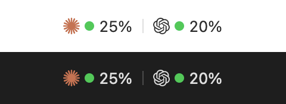
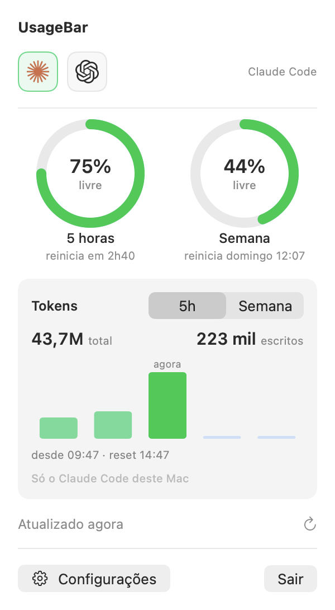
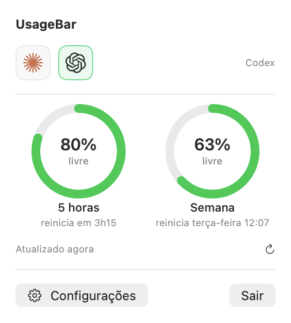
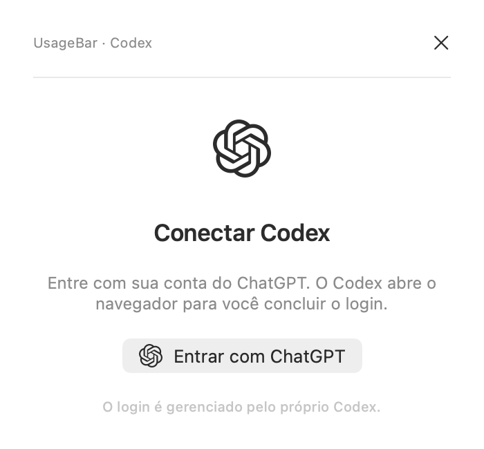
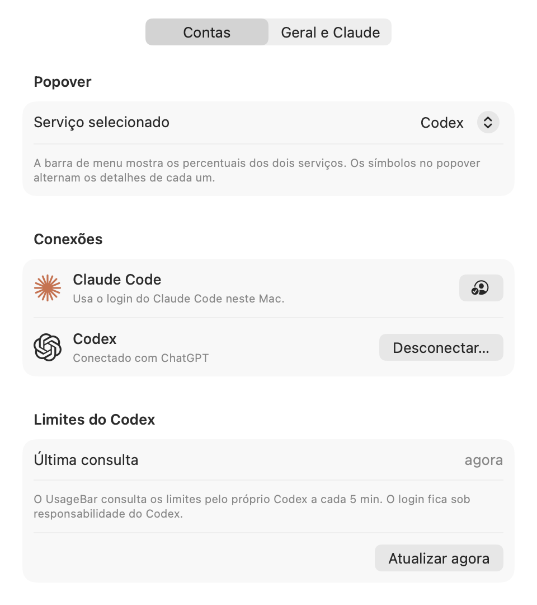

# UsageBar

App nativo para macOS que acompanha os limites de **Claude Code e Codex**, direto na barra de menu.
Os dois percentuais ficam visíveis ao mesmo tempo, cada um com seu símbolo. Ao clicar, os atalhos no topo
alternam os detalhes do serviço: quanto resta em cada janela e quando o limite reinicia.



| Claude Code | Codex |
|---|---|
|  |  |

As imagens mostram os componentes nativos do app com **dados fictícios**. Não são capturas de contas ou da área de trabalho.
Estas funções e imagens correspondem à série **0.2.x**. As releases anteriores, **0.1.x**, acompanham apenas o Claude.

## O que aparece

- **Na barra de menu:** percentual **usado** da janela principal de cada serviço. A bolinha indica a faixa de uso
  da segunda janela, normalmente semanal. Sem leitura disponível, aparece `--%`.
- **Nos anéis:** percentual **livre**, com o horário ou o tempo até o reset. As durações do Codex vêm da resposta do CLI.
- **Cores:** verde abaixo de 60% usado, amarelo de 60% a 85%, vermelho acima de 85%, conforme o percentual arredondado exibido.
- **Tokens do Claude:** total e escritos, com gráfico por hora ou de segunda a domingo. A contagem inclui somente
  os históricos do Claude Code neste Mac; não inclui a web nem outros computadores. A semana do gráfico segue o
  calendário local e pode ser diferente da janela semanal do servidor.
- **Codex:** nesta versão, mostra limites e resets, sem gráfico de tokens.

Os símbolos no popover alternam os detalhes; os dois percentuais continuam visíveis na barra de menu.
A última seleção é lembrada entre aberturas. O app fica fora do Dock e pode abrir ao iniciar a sessão.

## Requisitos

- macOS 14 (Sonoma) ou superior.
- Para acompanhar o Claude: Claude Code instalado e autenticado em uma conta que forneça os limites do plano
  (Pro/Max nas amostras validadas).
- Para acompanhar o Codex: Codex CLI instalado, com suporte a `app-server` e login via ChatGPT.
  Login apenas com API key não fornece os limites de assinatura exibidos pelo app.
- **Para compilar:** Xcode ou Command Line Tools, com Swift 5.9 ou superior. Quem baixa o app pronto não precisa do Swift.

Cada serviço tem sua própria conexão e seu próprio cache. É possível usar um deles enquanto o outro está sem dados.

## Instalação e atualização

### Baixar o app pronto

1. Consulte as notas e baixe o `UsageBar.zip` da versão desejada em [Releases](https://github.com/Pamplona-C/UsageBar/releases).
2. Feche o UsageBar, descompacte o arquivo e mova `UsageBar.app` para `~/Applications`, substituindo a versão anterior.
3. Abra o app. Os CLIs continuam responsáveis pelos seus logins.

O app é assinado **ad-hoc**, sem Developer ID ou notarização. Se o Gatekeeper bloquear o arquivo baixado, tente abrir
uma vez e use Ajustes do Sistema → Privacidade e Segurança → **Abrir Mesmo Assim**. Para um download de origem
conferida, também é possível remover a quarentena:

```bash
xattr -dr com.apple.quarantine ~/Applications/UsageBar.app
```

O binário acompanha a arquitetura da máquina que o compilou; o script não gera um binário universal.

### Compilar o código atual

Dentro do repositório:

```bash
./build-app.sh
```

O script compila em release, empacota e verifica a assinatura, fecha a versão em execução, instala em `~/Applications`
e abre o app. A atualização preserva suas preferências. Outras opções:

```bash
./build-app.sh --no-open       # instala sem abrir
./build-app.sh --package-only  # gera .build/app/UsageBar.app, sem instalar
```

## Conectar os serviços

### Claude Code

O app reconhece o login existente do Claude Code. Se precisar entrar novamente, use o botão de login em
Configurações → **Contas**, ou o botão que aparece quando a consulta informa falta de login. O Terminal executa
`claude auth login`, e o Claude conduz a autenticação.

Para receber também as atualizações de cada resposta, configure o bridge:

- **Pelo app:** Configurações → **Geral e Claude** → **Configurar statusline…**.
- **Pelo terminal:** `scripts/install-bridge.sh`.

O instalador pede confirmação antes de alterar `~/.claude/settings.json`, cria um backup privado com timestamp e
sufixo aleatório, e preserva a statusline original. Rodar novamente atualiza o script sem duplicar o encadeamento.
Para atualizar um bridge já instalado com as correções de segurança, execute `scripts/install-bridge.sh` novamente.

### Codex

Clique no símbolo do ChatGPT → **Conectar Codex** → **Entrar com ChatGPT**. O Terminal executa `codex login`,
e o próprio Codex abre o navegador para você concluir a autenticação. Se já houver login compatível, o app reconhece
a conta automaticamente.



Enquanto aguarda o login, o app verifica a conexão a cada 10 segundos. Também há **Já fiz login — atualizar**.
**Continuar depois** fecha a espera no UsageBar; o fluxo aberto no Terminal permanece sob controle do Codex.

Configurações → **Contas** reúne as conexões. Desconectar o Codex nessa tela desativa o acompanhamento e remove o
cache dele no UsageBar; não encerra o login compartilhado do CLI.



Para abrir junto com o Mac: Configurações → **Geral e Claude** → **Abrir ao iniciar sessão**. Se necessário, aprove o
UsageBar em Ajustes do Sistema → Geral → Itens de Início. Depois de recompilar, pode ser necessário desligar e ligar
essa opção novamente, pois a assinatura ad-hoc muda.

## Fontes dos dados e privacidade

**Claude:** a cada 5 minutos, ao abrir seu popover (com intervalo mínimo de 1 minuto) e ao atualizar manualmente,
o app executa o `/usage` do Claude Code em modo seguro, sem persistência de sessão. O relatório é a referência para
o uso da conta. Entre consultas, o bridge grava o JSON recebido pela statusline e o app observa esse arquivo.
Sessões paradas não podem reduzir a melhor leitura conhecida. Os tokens são somados dos históricos locais, de forma
incremental, fora da interface. Detalhes em [usage-report.md](docs/usage-report.md), [payload.md](docs/payload.md) e
[transcripts.md](docs/transcripts.md).

**Codex:** o app inicia uma conexão curta com `codex app-server`, inicializa o protocolo e usa `account/read` e
`account/rateLimits/read`. Não cria conversas ou turnos. A consulta acontece no início, a cada 5 minutos, ao abrir os
detalhes (com intervalo mínimo de 1 minuto) e manualmente. Detalhes em [codex.md](docs/codex.md).

O UsageBar não lê arquivos de credenciais ou o Keychain, não guarda tokens de autenticação e não chama endpoints
privados diretamente. Os CLIs gerenciam o login e a comunicação com seus serviços. O código do app não implementa
telemetria ou envio dos históricos para outro servidor.

Os arquivos `~/.claude/usagebar/` e os backups de `settings.json` são **dados locais privados**. O bridge salva o
payload integral da statusline, que pode conter caminhos e metadados de sessões; esses arquivos não devem ser
publicados. O instalador usa permissões restritas e evita exibir o comando original da statusline nos resultados.
O cache de percentuais e as preferências ficam em `UserDefaults`, separados por serviço.

Os formatos dos CLIs podem mudar. Uma falha de consulta mantém a última leitura válida, com aviso de erro; uma
confirmação de falta de login no Codex remove seus dados antigos. O app não transforma tokens em percentuais nem
calcula custos financeiros.

## Desinstalação

1. Remova o bridge antes de apagar o app: Configurações → **Geral e Claude** → **Remover bridge…**, ou
   `scripts/uninstall-bridge.sh`. A statusline original é restaurada, com backup antes da alteração.
2. Desligue **Abrir ao iniciar sessão** e clique em **Sair**.
3. Remova o app, o estado local do bridge e as preferências:

   ```bash
   rm -rf ~/Applications/UsageBar.app ~/.claude/usagebar
   defaults delete com.gustavopamplona.UsageBar
   ```

Os backups `~/.claude/settings.json.bak-*` permanecem; remova-os separadamente quando não precisar mais deles.
Desinstalar o UsageBar não desinstala os CLIs nem encerra seus logins.

## Desenvolvimento e publicação

```bash
swift test
swift run
python3 tools/check-publication.py
python3 tools/render-doc-images.py
```

Os testes usam CLIs falsos, fixtures de exemplo e diretórios temporários. Não consultam contas reais nem modificam
seus arquivos de configuração. O gerador de imagens usa os mesmos componentes SwiftUI, com dados sintéticos.

O workflow de segurança executa Gitleaks no histórico Git e verifica os arquivos candidatos e metadados de imagens.
Também bloqueia e-mails pessoais nos novos autores/committers; use o endereço `noreply` do GitHub para os commits públicos.
Os metadados históricos explicitamente aprovados pelo mantenedor estão limitados aos hashes em `.publication-policy.json`.
Para incluir essa verificação na revisão local, execute `python3 tools/check-publication.py --history`.
Para revisar localmente com Gitleaks instalado:

```bash
gitleaks git . --log-opts=--all --redact=100
```

Depois de revisar o conteúdo e a privacidade do histórico, uma tag `v*` aciona o workflow de release: testes,
empacotamento e publicação de `UsageBar.zip`. Exemplo para a próxima versão:

```bash
git tag v0.2.0
git push origin v0.2.0
```

O símbolo OpenAI vem de Bootstrap Icons, sob licença MIT; a atribuição está em
[THIRD_PARTY_NOTICES.md](THIRD_PARTY_NOTICES.md) e acompanha o app empacotado.
